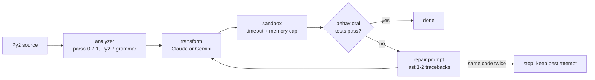

<div align="center">

# CodeShift

### An LLM agent that ports Python 2 code to Python 3, then proves the port still behaves the same.

*Claude and Gemini both passed the same 39 of 41 cases and failed the same two.*

<br/>

[](#-try-it-no-api-key)
[](#-the-finding)
[](https://gaurangkhurana.ca)

<br/>


[](https://github.com/gkhurana21/codeshift/actions/workflows/test.yml)


[The problem](#the-problem) • [How it works](#-how-it-works) • [The finding](#-the-finding) • [Try it](#-try-it-no-api-key) • [Under the hood](#-under-the-hood)

</div>

---

## The problem

Tools like `2to3` fix syntax. But a lot of Python 2 code still runs on Python 3 and quietly returns different
answers. `7 / 2` was `3` and is now `3.5`. A `str` used to be bytes. A re-raised exception now drags the old one
along with it. Nothing crashes. The numbers are just wrong.

## The fix

**CodeShift checks what the migrated code *does*, not just whether it parses.** Every case comes with hand-written
tests that pin down what the Python 2 program actually returned. The agent migrates the file, runs those tests in a
sandbox, reads the failures and repairs, until the tests pass or the budget runs out.

<table>
<tr>
<td align="center" width="25%"><h3>95.1%</h3><sub>39 of 41 cases passed, on both models</sub></td>
<td align="center" width="25%"><h3>41 / 41</h3><sub>oracles proven to fail on unmigrated code, checked in CI</sub></td>
<td align="center" width="25%"><h3>Identical</h3><sub>pass/fail on every case across Anthropic and Google</sub></td>
<td align="center" width="25%"><h3>55%</h3><sub>of Gemini's tokens for Claude to reach the same score</sub></td>
</tr>
</table>

## 🔁 How it works

<table>
<tr>
<td width="50%"><b>1. Analyze.</b> A <a href="https://github.com/davidhalter/parso">parso</a> static analyzer reads the file with the Python 2.7 grammar and flags every Py2 construct, keeping mechanical rewrites apart from the risky ones (division, <code>str</code>/<code>bytes</code>, exceptions).</td>
<td width="50%"><b>2. Transform.</b> The model gets the source plus those findings and writes a Python 3 version. Claude or Gemini, picked by the model name.</td>
</tr>
<tr>
<td><b>3. Verify.</b> The new code runs against its behavioral tests in a sandboxed subprocess with a timeout and a memory cap. Passing means it returns what Python 2 returned.</td>
<td><b>4. Repair.</b> On a failure the model sees only the latest one or two tracebacks and tries again. It stops on repeated code, keeps the best attempt, and respects token and iteration budgets.</td>
</tr>
</table>

## 🎯 The finding

41 cases, each built around one Python 2 to 3 trap. The categories the agent should struggle with were written down
**before** any model ran, so the failures landed where they were predicted, not explained afterwards.

| Band | Cases | Gemini 2.5 Flash | Claude Sonnet 4.6 |
|---|---:|---:|---:|
| Mechanical | 21 | 21/21 | 21/21 |
| Ambiguous from the source alone | 12 | 12/12 | 12/12 |
| Has one right answer, easy to miss | 6 | 4/6 | 4/6 |
| Several traps in one file | 2 | 2/2 | 2/2 |
| **Overall** | **41** | **39/41** | **39/41** |
| Tokens used | | 122,748 | 67,527 |

Two models from different companies got the same pass or fail on **every one of the 41 cases**. Both missed the
same thing in both failures:

```python
# what both models wrote
except KeyError as e:
    raise AppError('missing config key: ' + str(e))

# what keeps Python 2's behavior
except KeyError as e:
    raise AppError('missing config key: ' + str(e)) from None
```

Both fixed the old `except KeyError, e:` syntax. Neither added `from None`, so the original `KeyError` stays attached
to the new error as `__context__`, which Python 2 never did. Repair loops on both models got stuck on the same
answer. With two models that's a strong hint, not proof, that this is a blind spot of LLMs in general rather than of
one model.

## ⚡ Try it (no API key)

```bash
git clone https://github.com/gkhurana21/codeshift.git && cd codeshift
python3 -m venv .venv && .venv/bin/pip install -r requirements.txt
.venv/bin/python -m scripts.demo_migration_scripted
```

A scripted model drives the real loop, sandbox and tests. Its first try leaves a `/` where Python 2 meant floor
division, a test catches it, and the repair goes from 5/6 to 6/6 passing.

## 🔧 Under the hood

<details>
<summary><b>The loop, the benchmark, how to run the real thing, and the engineering</b></summary>

### The loop



* **Oscillation guard.** If a repair produces code identical to an earlier attempt, the loop stops instead of spending tokens going in circles.
* **Best attempt wins.** The attempt with the most tests passing is kept, ties go to the earliest.
* **Budgets.** Every run has a token cap and an iteration cap. Each iteration logs one greppable line: `iter=N case=NAME passed=P failed=F action=...`.
* **One router.** `build_llm_client()` sends `claude-*` to Anthropic and `gemini-*` to Google. Quota errors stop a benchmark run cleanly instead of burning retries.

### The benchmark

* **Behavioral oracles.** Each case is a `source_py2.py` and a `test_behavior.py` that asserts what Python 2 returned: values, exception types, side effects.
* **Bite-checked.** Every oracle must *fail* on its own unmigrated source, or it isn't testing anything. `python -m benchmark.bite_check` proves it for all 41, and CI runs it on every push.
* **Honest bands.** In the "ambiguous" band a pass only means the model matched the one reading the test pins down, not that it recovered the author's intent. `csv_field_builder` is a known coin flip.
* **One run, reported as is.** Each model ran the 41 cases once. No re-rolls to improve a number.

Full methodology, the pre-registered categories, per-case results and known limitations are in
[docs/METHODOLOGY.md](docs/METHODOLOGY.md). Writing a new case is covered in [benchmark/README.md](benchmark/README.md).

### Run the real thing

```bash
cp .env.example .env    # add GEMINI_API_KEY (free tier works) or ANTHROPIC_API_KEY

# Migrate one file with a real model
.venv/bin/python -m agent.migrate samples/migration_demo/source_py2.py --model gemini-2.5-flash

# The full 41-case benchmark
.venv/bin/python -m benchmark.run_all --model gemini-2.5-flash
.venv/bin/python -m benchmark.run_all --model claude-sonnet-4-6

# No keys needed
.venv/bin/python -m pytest tests/           # unit tests
.venv/bin/python -m benchmark.bite_check    # every oracle fails on unmigrated code
```

### Engineering

* **94 unit tests** run offline with a scripted `FakeChatModel`, so CI needs no API keys. CI runs them and the bite-check on Python 3.11, 3.12 and 3.13.
* **Hardened sandbox** for benchmark runs: process-group kill on timeout, `RLIMIT_AS` memory cap, and guards against stale `.pyc` files.
* **parso is pinned to 0.7.1** on purpose. It's the last release that ships the Python 2.7 grammar.

### Layout

```
analyzer/     parso static analyzer: Py2 constructs, mechanical vs semantic risk
agent/        repair loop, prompts, LLM router (Claude, Gemini)
sandbox/      subprocess runners: local (dev) and hardened (benchmark)
benchmark/    41 cases, the runner, the bite-check
docs/         full methodology and results
```

</details>

## License

MIT. See [LICENSE](LICENSE).
